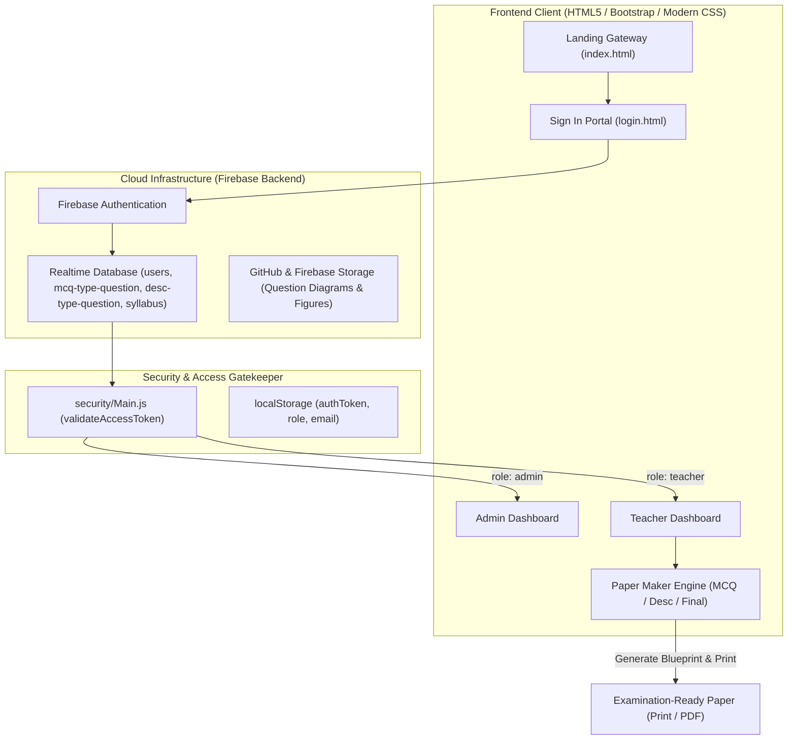

# 🎓 ExamCraft — Academic Question Paper Generation & Question Bank Management System

[](https://nachiket1311.github.io/Portal_For_Teachers/)
[](https://firebase.google.com/)
[](https://developer.mozilla.org/en-US/docs/Web/JavaScript)
[](https://getbootstrap.com/)
[](https://developer.mozilla.org/en-US/docs/Web/HTML)
[](https://developer.mozilla.org/en-US/docs/Web/CSS)
[](LICENSE)

An enterprise-grade academic platform designed for schools, colleges, and examination boards to streamline **Question Bank Management**, **Faculty Submissions**, **Curriculum Moderation**, and **Automated Question Paper Generation** with print/PDF export.

🌐 **Live Demo Portal**: [https://nachiket1311.github.io/Portal_For_Teachers/](https://nachiket1311.github.io/Portal_For_Teachers/)  
🔑 **Direct Login Screen**: [https://nachiket1311.github.io/Portal_For_Teachers/login/login.html](https://nachiket1311.github.io/Portal_For_Teachers/login/login.html)

---

## 🔑 Demo Access Credentials

The portal features built-in **1-Click Quick Demo Access** buttons on the login screen, or you can enter the credentials manually:

| Role | Username | Password | Access Scope |
| :--- | :--- | :--- | :--- |
| 👑 **Administrator** | `Admin` | `123456` | Full system moderation: approve/reject submitted questions, manage syllabi and chapters, oversee educator accounts |
| 👩‍🏫 **Teacher / Educator** | `Teacher` | `123456` | Question authoring, bulk Excel uploads, submission tracking, and automated question paper generation with print engine |

> [!TIP]
> On the login page, you can click either the **👑 Demo Admin** or **👩‍🏫 Demo Teacher** chip to automatically populate the username and password with a single tap.

---

## 🏛️ System Architecture



---

## ✨ Key Features & Capabilities

### 👑 1. Administrator Command Center (`mainadmin/`)
- **Interactive Metrics & Realtime Counters**:
  - Live counts of total registered users partitioned by role (Admins, Teachers, Students).
  - Real-time tally of **MCQ** and **Descriptive** questions across moderation states: `Approved`, `Pending`, and `Rejected`.
- **Question Review & Moderation Workflow**:
  - Review questions submitted by faculty members with full options, answer keys, diagrams, and chapter mappings.
  - One-click approval to graduate questions into the institutional exam question bank.
  - Review rejection handling with status flags.
- **Curriculum & Syllabus Configuration**:
  - Add, edit, and organize educational standards (e.g. 8th, 9th, 10th, 12th), subjects, and chapters.
- **User Role Management**:
  - Audit educator access, role assignments, and account statuses.

### 👩‍🏫 2. Educator & Paper Maker Hub (`mainteacher/`)
- **Multi-Format Question Ingestion**:
  - **Bulk MCQ Upload**: Ingest hundreds of multiple-choice questions via Excel/CSV spreadsheets.
  - **Bulk Descriptive Upload**: Upload short, medium, and long-answer descriptive questions with marking rubrics.
  - **Sample Excel Format Generator**: Download pre-formatted Excel template files directly from the dashboard to ensure schema compliance.
  - **Image Questions**: Upload diagrams, geometric figures, and mathematical graphs stored in the cloud.
- **Submission History**:
  - "Uploaded by me" personalized filter to track the review status of authored questions.
  - Master pool browser to review school-wide approved questions.

### 📄 3. Automated Question Paper Generator Suite (`papermaker/`)
The Paper Maker suite generates structured, syllabus-compliant examination papers on demand:
- **MCQ Exam Paper**:
  - Filter by Standard, Subject, Medium (English/Marathi), and multi-select Chapters.
  - Specify the exact number of questions; the algorithm randomly selects from the verified question bank.
- **Descriptive Exam Paper**:
  - Filter by chapters and required question counts for short and long-form subjective examinations.
- **Semester / Final Exam Multi-Tier Blueprint**:
  - Generates comprehensive examination papers adhering to standardized institutional grading structures:
    - **Q1-A**: Multiple Choice Questions (1 Mark each)
    - **Q1-B**: Objective / Short Answer (1 Mark each)
    - **Q2-A**: Short Conceptual (2 Marks each — Solve any 2)
    - **Q2-B**: Analytical (2 Marks each — Solve any 3)
    - **Q3**: Comprehensive Problem Solving (3 Marks each — Solve any 5)
    - **Q4**: Long-Form Essay / Theory (5 Marks each — Solve any 1)
- **🖨️ Clean Print & PDF Engine**:
  - Dedicated print stylesheets (`@media print`) strip background gradients, navigation elements, and interactive controls.
  - Renders pristine, high-contrast, black-and-white exam papers ready for physical printing or PDF distribution.

---

## 📂 Project Directory Structure

```plaintext
Portal_For_Teachers/
├── .github/
│   └── workflows/
│       └── deploy-pages.yml       # Automated GitHub Actions deployment workflow
├── .nojekyll                      # Disables Jekyll processing for GitHub Pages
├── index.html                     # Gateway landing page with auto-redirect & role guide
├── README.md                      # Comprehensive project documentation
├── security/
│   └── Main.js                    # Firebase project configuration & token route guard
├── login/
│   ├── login.html                 # Sign-in interface with 1-click demo chips & bubble animation
│   ├── login.css                  # Modern glassmorphism styling
│   └── login.js                   # Firebase authentication, role routing, & state persistence
├── mainadmin/                     # Administrator Section
│   ├── admin/                     # Admin View Templates
│   │   ├── dashboard.html         # Main administration control panel
│   │   ├── bulkmcq.html           # Bulk MCQ question upload
│   │   ├── bulkdesc.html          # Bulk descriptive question upload
│   │   ├── image.html             # Question diagram and image gallery
│   │   ├── pending-questions.html # Pending MCQs awaiting approval
│   │   ├── accepted-questions.html# Approved MCQs
│   │   ├── rejected-questions.html# Rejected MCQs
│   │   ├── Totalq.html            # Total MCQ master pool
│   │   ├── desc-*.html            # Corresponding descriptive status workflows
│   │   ├── manage-chapter.html    # Syllabus and chapter management
│   │   └── usermanegment.html     # User directory and role permissions
│   ├── css/                       # Admin stylesheets (dashboard.css, bulk, images)
│   └── js/                        # Admin data sync and Firebase handlers
└── mainteacher/                   # Teacher Section
    ├── teacher/                   # Teacher View Templates
    │   ├── dashboard.html         # Educator hub and Paper Maker launcher
    │   ├── bulkmcq.html           # Bulk MCQ authoring
    │   ├── bulkdesc.html          # Bulk descriptive question authoring
    │   ├── image.html             # Diagram question upload
    │   ├── uploadedbyuser.html    # Personal submission tracking
    │   ├── Totalq.html            # School-wide approved question browser
    │   └── papermaker/            # Examination Blueprint Engine
    │       ├── html/
    │       │   ├── MCQ-Pattern.html   # MCQ paper builder
    │       │   ├── desc-pattern.html  # Descriptive paper builder
    │       │   └── final-pattern.html # Multi-tier final exam paper builder
    │       ├── css/
    │       │   ├── MCQ-pattern.css    # MCQ paper & print styling
    │       │   ├── desc-pattern.css   # Descriptive paper & print styling
    │       │   └── final-pattern.css  # Final exam paper & print styling
    │       └── js/
    │           ├── MCQ-Pattern.js     # Random sampling & option mapping
    │           ├── desc-pattern.js    # Subjective section marks allocation
    │           ├── final-pattern.js   # Comprehensive multi-part assembly
    │           └── print.js           # Print / PDF export trigger
    ├── css/                       # Teacher stylesheets
    └── js/                        # Teacher client logic & Excel format downloads
```

---

## 🚀 Running Locally

You can serve this static site using any local HTTP web server:

### Option 1: Python HTTP Server
```bash
# Clone the repository
git clone https://github.com/Nachiket1311/Portal_For_Teachers.git
cd Portal_For_Teachers

# Launch Python web server
python3 -m http.server 8080
```
Open your browser and navigate to: `http://localhost:8080/`

### Option 2: Node.js `serve` / `http-server`
```bash
npx serve .
# or
npx http-server -p 8080
```

### Option 3: VS Code Live Server
1. Open the `Portal_For_Teachers` folder in VS Code.
2. Right-click `index.html` and click **"Open with Live Server"**.

---

## 🗄️ Database & Schema Overview

The application interfaces with **Firebase Realtime Database**:

- `users/{uid}`: Stores registered user profiles (`name`, `email`, `username`, `role` (`admin` | `teacher` | `student`)).
- `mcq-type-question/{questionId}`: Multiple-choice items containing question text, 4 options (`A`, `B`, `C`, `D`), correct option, standard, subject, chapter, medium, author UID, and moderation `status` (`pending` | `Approved` | `Rejected`).
- `desc-type-question/{questionId}`: Descriptive questions with text, marks allocation, standard, subject, chapter, author, and review status.
- `standards/`, `subjects/`, `chapters/`: Academic syllabus taxonomy hierarchy.

---

## 👨‍💻 Author

**Nachiket Palekar**  
- 🎓 *MBA Tech Computer Engineering Student at NMIMS Navi Mumbai*
- 🌐 *Portfolio*: [https://nachiket1311.github.io/Personal_Web/](https://nachiket1311.github.io/Personal_Web/)
- 💻 *GitHub*: [@Nachiket1311](https://github.com/Nachiket1311)
- 💼 *LinkedIn*: [nachiket-palekar](https://in.linkedin.com/in/nachiket-palekar)

---

## 📄 License

This project is licensed under the [MIT License](LICENSE).
